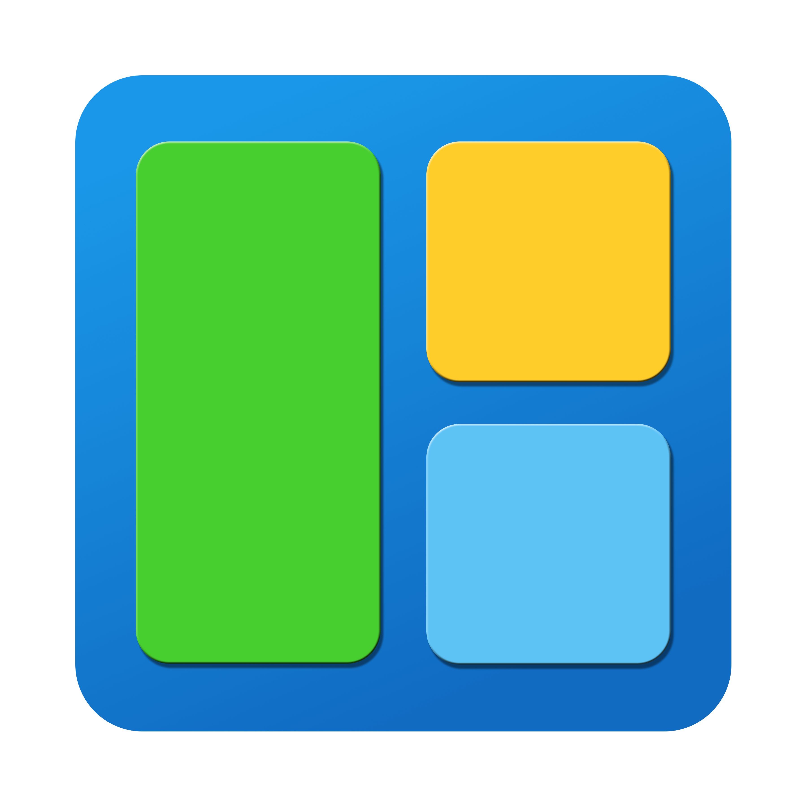
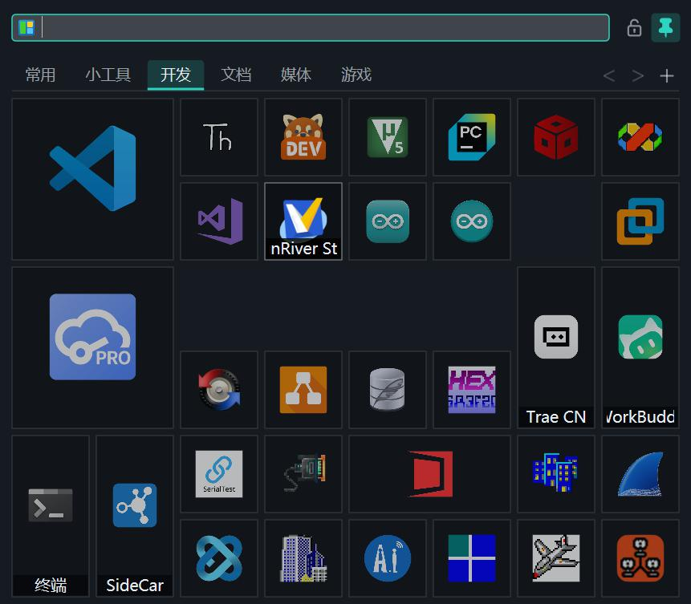
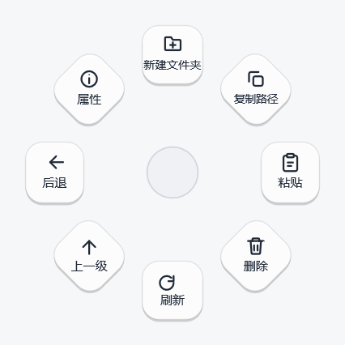

<div align="center">



# KTile

**Keep the apps, files, folders and links you use every day on a tile panel you
can summon anywhere; then hang your most frequent actions off the mouse and
reach them with a single drag.**

*Lightweight · single binary · no install · offline*

[简体中文](README.md) · **English**

[](https://www.microsoft.com/windows)
[](#)
[](LICENSE)
[](CHANGELOG.md)
[](#)

</div>

---

## Preview

<p align="center">
  
  <br>
  <sub>The tile panel: four sizes mixed freely, grouped into tabs</sub>
</p>

<p align="center">
  
  <br>
  <sub>The wheel menu: hold <code>Ctrl</code> and drag the right button; release to run the highlighted sector
  (the wheel of the File Explorer plugin in this shot)</sub>
</p>

## What's new in v1.3.1

- **Launch with KTile** — in Settings → Behavior, in the "Startup and activation"
  group right below Start with Windows, you can attach a list of programs to come up
  together with KTile: pick them with "Add…" (exe / lnk / bat / cmd / com) and the
  list shows each one's icon and path. Anything already running is skipped —
  including programs started through an app-execution alias (Notepad, Calculator),
  so you never end up with two copies
- **"Launch with KTile" in a tile's context menu** — no file dialog to wade through:
  tick it on the tile, tick again to remove. Entries added this way start **the way
  the tile does**: arguments, start-in folder and administrator flag all come from
  the tile and follow later edits. If the tile is deleted the entry keeps working
  from the snapshot taken when it was added. Only offered on executable tiles
- **Relative tile targets** — a target like `tools\app.exe` is resolved against the
  folder containing `KTile.exe`, not the current working directory: launching from a
  shortcut, a scheduled task or an arbitrary folder all resolve the same way.
  Launching, icons, type inference and "open file location" share one resolver
- Fixed: labels in the item editor were clipped in English; the layout now measures
  the current language instead of assuming four Chinese characters

v1.3.0 brought wheel plugins (`slugin/`), the bilingual UI, a single general wheel
plus a process blacklist, and modifier suppression keys. The full list is in
[CHANGELOG](CHANGELOG.md); the design notes for the wheel are in
[docs/radial-menu-design.md](docs/radial-menu-design.md) (in Chinese).

## What it is

KTile is a native Windows tile launcher: keep the things you use in tiles of
freely mixed sizes, summon the panel with a hotkey, type to filter, click to run.

The whole program is a single `KTile.exe` of about **1.3 MB** — no installer, no
runtime, completely offline. Settings and data live in a `data` folder next to the
executable, so copying the folder is your backup.

## Why I built it

I liked the Windows 10 Start-menu tiles: icons of different sizes, arranged freely,
the important things made large and the small utilities tucked in around them.
Windows 11 dropped tiles, and Windows 7 never had them.

Worse, when my Windows 10 install was reset once, everything else survived — but
**the tile layout was gone**, and those carefully arranged squares could not be put
back together. I tried every launcher I could find afterwards: all capable, none of
them with that free-form tile feeling.

So I spent a weekend writing one with AI assistance. The goals were simple:
lightweight, practical, and tiles of different sizes that can be combined freely.
That is what you are looking at.

## Features

### 1. Tiles: click to launch — and bring your everyday tools along

The tiles are the main window. Four sizes (Small / Wide / Tall / Large) mix freely,
the grid dimensions are configurable, and tabs group things by purpose. Summon the
panel, type a few letters to filter by name, click to run.

**Launch with KTile** extends that beyond the panel: attach the programs you always
keep running (sync clients, input methods, chat windows) to the "Launch with KTile"
group in Settings → Behavior — the "Startup and activation" group, right below
Start with Windows. They come up when KTile does, and anything already running is
skipped, so nothing is opened twice.

The quicker way to add one is to tick it in a tile's context menu. Entries added
that way start **the way the tile does** — arguments, start-in folder and
administrator flag all come from the tile and follow later edits; if the tile is
deleted, the entry keeps working from the snapshot taken when it was added.

The trigger is "when KTile starts", regardless of how KTile itself was started
(sign-in, tray, hotkey, clicking a tile). The `--debug-*` automation entry points
do not run it, so a screenshot script does not leave a pile of processes behind.

> **Image placeholder** `docs/feature-follow.gif`: tick "Launch with KTile" on a
> tile, restart KTile, watch the program come up (screenshot or GIF)

### 2. Tile plugins: a tile is not just an icon

A tile can show live content: CPU and memory usage, disk, battery, weather, the
response of any HTTP API, the output of a command.

Plugins are **purely declarative**: `plugin/<id>/plugin.json` describes the data
source (local metrics / HTTP / command line) and a layout tree per tile size. No
code to write, no background process to run. One plugin can give a different layout
for each size — three days of weather side by side on a large tile, only today on a
small one. `refreshSeconds` is the cache TTL when the panel is summoned;
`visibleRefreshSeconds` is the refresh interval while the panel is open (one second
for the system monitor) and stops when the panel hides. Two examples ship with the
package — Weather and System Monitor — installable and removable in Settings.

> **Image placeholder** `docs/feature-plugin.gif`: installing a tile plugin and
> watching it refresh (screenshot or GIF)

### 3. Wheel menu: one per app, blind-operable once you are fluent

Hold `Ctrl` and drag the right button: a radial menu opens at the cursor, drag
towards a sector and release to run it — no confirm click in between. Four, six or
eight sectors; both the trigger and the modifier are configurable.

- **One wheel per application** — adding a folder under `slugin/` adds an app:
  `radial.json` lists the process names it applies to and the sector actions. Switch
  to that program and its wheel appears; anything unmatched falls back to the general
  wheel. No code, no recompile
- **Blind operation once you are used to it** — sectors stay in place, so within a
  few days it is muscle memory, and a drag is faster than hunting through a menu
- **Legible when it is new** — every sector carries an icon and a name, so you can
  look before you choose instead of memorising anything
- **Coexists with gesture software** — a modifier is required by default, so plain
  right-click is never hijacked; suppression keys let `Alt+Tab`, `Alt+arrow` and
  friends through, and individual processes can be blacklisted entirely

In my own use it has replaced mouse gestures: gestures have to be memorised stroke
by stroke, while the wheel keeps every candidate in view — and if you drift towards
the wrong sector you can still correct before releasing.

> **Image placeholder** `docs/feature-radial.gif`: switching to a browser swaps the
> wheel for that app's set, then one drag runs an action (screenshot or GIF)

### 4. Multiple languages: switch the UI language at will

Simplified Chinese and English are built in. The first run follows the system
language (Chinese if the system is Simplified Chinese, English otherwise); after
that, switch at any time in Settings → Behavior → Interface language, no restart
needed.

All text lives in `lang/<code>.json` next to the executable: **adding a language is
adding a file**, with no code change and no recompile. Lookup falls back from the
current language to English to the key itself, so a missing translation shows
something like `settings.title` instead of a blank, which is far easier to track
down. Details in [docs/i18n.md](docs/i18n.md) (in Chinese).

> **Image placeholder** `docs/feature-i18n.png`: the same screen in Chinese and in
> English (two screenshots side by side is fine)

### Everything else

- **Three ways to add a tile** — browse for a file, paste a target path, drag in from Explorer
- **Relative targets** — `tools\app.exe` is resolved against the folder holding
  `KTile.exe`, so moving the whole folder to another drive needs no edits; a bare
  command name (`notepad.exe`) still goes through `PATH`
- **Custom icons** — any image as a tile icon (scaled on import), or use the system icon
- **Built-in system items** — 21 common locations and commands (This PC, Recycle Bin,
  lock screen, volume and media keys…)
- **Skins** — four dark and one light built-in theme; skin files are editable JSON,
  and a separate background image is supported
- **Opacity** — window and tiles adjustable separately
- **Summon hotkey** — `Alt+Space` / `Ctrl+Space` / double-tap `Ctrl` / single `Win`,
  switchable in Settings
- **Window position** — at the cursor / screen corners / centred / last position
- **Portable** — writes nothing to the registry (the one exception is "start with
  Windows", which stores the executable path under the Run key)

## Two kinds of plugins: one tile, one wheel

Extensibility splits into two independent lines. Both are "drop a folder in and it is
installed": no code, no recompile, and the main program embeds neither manifests nor
icons.

| | Tile plugins `plugin/` | Wheel plugins `slugin/` |
|---|---|---|
| Solves | **Live content** inside a tile (weather, CPU, HTTP responses) | A **different wheel** per foreground app |
| Manifest | `plugin/<id>/plugin.json` | `slugin/<id>/radial.json` |
| Data source | Local metrics / HTTP / command line | Purely static: process names + sector actions |
| Activation | Settings → Plugins → install / remove | Settings → Radial plugins → rescan |
| Icons | `plugin/<id>/icons/*.svg` | `slugin/<id>/icons/*.svg` |
| Examples shipped | Weather, System Monitor | File Explorer, Browser |

When the executable folder is not writable (installed under `Program Files`, say),
both fall back to `data/plugin/` and `data/slugin/`. Manifest fields are documented
under [Data and configuration](#data-and-configuration).

## Shortcuts

| Key | Action |
|------|------|
| `Alt+Space` (default, configurable) | Show / hide the panel |
| Typing | Filter tiles by name |
| `Esc` | Clear the search / hide the panel |
| `Ctrl+Tab` / `Ctrl+1..9` | Switch tabs |
| `Ctrl` + right-drag (default, configurable) | Open the wheel menu, release to run the highlighted sector |
| Dragging a tile | Reorder (the others make room) |
| Right-clicking a tile | Run, edit, resize, move/copy to another page… |

## Quick start

1. Download `KTile.zip` from [Releases](https://github.com/svyee/KTile/releases) and
   unpack it anywhere
2. Run `KTile.exe` (sample tiles are there on first launch — edit them into your own)
3. Press `Alt+Space` to summon the panel

> Windows SmartScreen may warn about an unsigned binary on first run; choose
> "More info → Run anyway". You can also build it yourself, see below.

## UI language

See [section 4](#4-multiple-languages-switch-the-ui-language-at-will) for the
feature. On disk, all text sits in `lang/<code>.json` next to the executable, where
`code` is the language tag (`zh-Hans`, `en`) and `auto` means "follow the system".
The full procedure for adding a language, and the pitfalls, are in
[docs/i18n.md](docs/i18n.md) (in Chinese).

## Data and configuration

```
KTile.exe
plugin/
└── <id>/
    ├── plugin.json   # tile plugin manifest (data source and per-size layout)
    └── icons/*.svg   # plugin icons (png also works; SVG supports partial colour)
slugin/
└── <id>/
    ├── radial.json   # wheel plugin manifest (target processes + sector actions)
    └── icons/*.svg   # wheel button icons (png / ico also work)
data/
├── items.json     # tile data (safe to edit by hand)
├── config.json    # application settings
├── radial.json    # general wheel (trigger / suppression keys / actions / blacklist)
├── themes/        # skins (JSON, colours are yours to change)
├── plugins/cache/ # plugin data snapshots (generated)
└── res/           # imported custom icons
lang/
├── zh-Hans.json   # Simplified Chinese strings
└── en.json        # English strings (a new language is a new file, see docs/i18n.md)
```

Tile plugins are declarative: `plugin/<id>/plugin.json` describes the data source
(built-in metric / HTTP / command line) and a layout tree per tile size. No code, no
background process. `refreshSeconds` is the cache TTL "when the panel is summoned";
`visibleRefreshSeconds` is the fast refresh interval "while the panel is open" (one
second for the system monitor); nothing refreshes once the panel hides. Plugins live
next to the executable, one folder each; if that folder is not writable the loader
falls back to `data/plugin/`. The repository's `plugin/` folder holds the examples
shipped with the release (Weather defaults to Quanzhou, Fujian; plus System Monitor)
and `build.ps1` copies it verbatim next to the executable — the main program embeds
no manifests or icons.

Settings → Plugins installs (pick a `plugin.json` and the whole folder is copied in),
removes plugins, or adds a tile for one directly.

### Wheel plugins (`slugin/`)

(These are listed as **Radial plugins** in Settings.)

A wheel plugin is "a folder + a manifest + its own icons": `slugin/<id>/radial.json`
lists the applicable process names in `processes` and describes the sectors in
`menu` (same fields as the general wheel). An action's `icon` is resolved relative to
the plugin folder. When the foreground process matches, that wheel is shown;
otherwise the general wheel is used. If several plugins match the same process, the
higher `priority` wins.

```json
{
  "schemaVersion": 1,
  "name": "File Explorer",
  "processes": ["explorer.exe"],
  "priority": 0,
  "menu": {
    "name": "Explorer",
    "sectorCount": 8,
    "actions": [
      { "type": "shortcut", "name": "New folder",
        "modifiers": ["control", "shift"], "key": "N",
        "icon": "icons/folder-plus.svg" }
    ]
  }
}
```

No restart needed after editing the JSON: Settings → Radial plugins → Rescan (editing
only icon files does not even need a rescan — the renderer invalidates on file
modification time). The repository's `slugin/` folder is the example shipped with the
release (File Explorer); `build.ps1` copies it next to the executable. Draw icons on a
24×24 canvas to match the built-ins; a broken manifest only skips that one plugin and
Settings says why.

Copying the whole folder to a USB stick or a new machine migrates everything.

## Building from source

**Requirements**: Visual Studio 2022 Build Tools (MSVC 14.44, C++17) and Windows SDK
10.0.26100.0. The toolchain paths are hard-coded at the top of `build.ps1`; adjust
those lines if your install location or version differs. No CMake, no vcpkg, no
third-party libraries.

```powershell
git clone https://github.com/svyee/KTile.git
cd KTile
.\build.ps1                  # Release build
.\build.ps1 -Debug           # Debug build
.\build.ps1 -Tests           # build and run the whole test suite
.\build.ps1 -Clean           # wipe the build folder
```

Output: `build/KTile.exe` (statically linked with `/MT`, no external dependencies).

**Stack**: plain Win32 + Direct2D + DirectWrite, no UI framework; JSON parsing and
serialisation are home-grown with zero dependencies. See the
[environment report](docs/environment-report.md) (in Chinese).

## Project layout

```
KTile/
├── src/
│   ├── app/            # application layer: lifetime, tray, hotkeys, debug entry points
│   ├── base/           # C++17 compatibility layer: expected / span / algo / text conversion
│   ├── core/           # domain: tile layout, plugin model/binding/layout, search, tab ops
│   ├── infrastructure/ # persistence: JSON reader/writer, portable paths, plugin manifests
│   ├── platform/win32/ # platform: D2D plumbing, icon extraction, drag & drop, hotkeys, plugin data sources
│   └── ui/             # interface: main window, item editor, settings window, skins
├── plugin/             # example tile plugins shipped with the release (copied into build/)
├── slugin/             # example wheel plugins shipped with the release (copied into build/slugin/)
├── tests/              # unit tests (one test_*.cpp per module)
├── tools/              # development-time code generation: Lucide icons, application ico
├── scripts/            # build environment scripts and diagnostic probes
├── docs/               # documentation and screenshots
├── assets/             # design sources (application icon master, icon.png)
├── build.ps1           # build script (drives cl.exe directly, no CMake)
└── build/              # build output (git-ignored)
```

## Contributing

Issues and pull requests are welcome.

- **Found a bug**: search the [issues](https://github.com/svyee/KTile/issues) first
- **Feature idea**: open an issue describing the situation and what you expect
- **Code**: fork the repository, work on a branch, open a pull request

A pull request should build and pass `.\build.ps1 -Tests`.

## Feedback

- Email: svyee@163.com
- WeChat: svyeee

## License

Released under the [MIT License](LICENSE).

Built-in icons are based on [Lucide](https://lucide.dev) (ISC License); see
[THIRD_PARTY_NOTICES.md](THIRD_PARTY_NOTICES.md).
