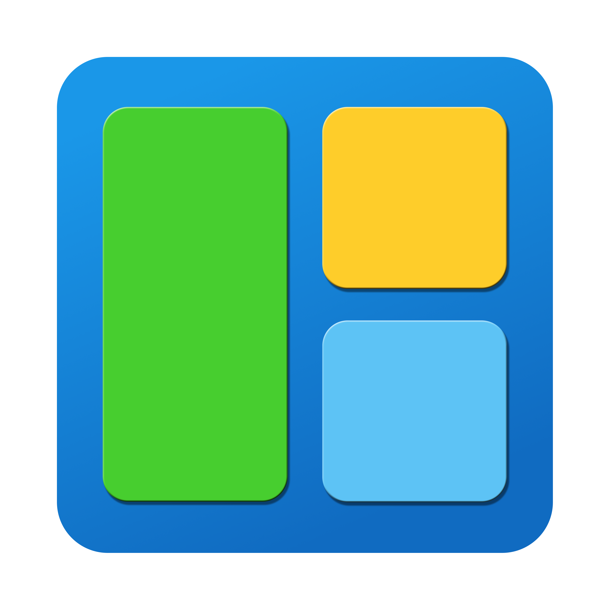
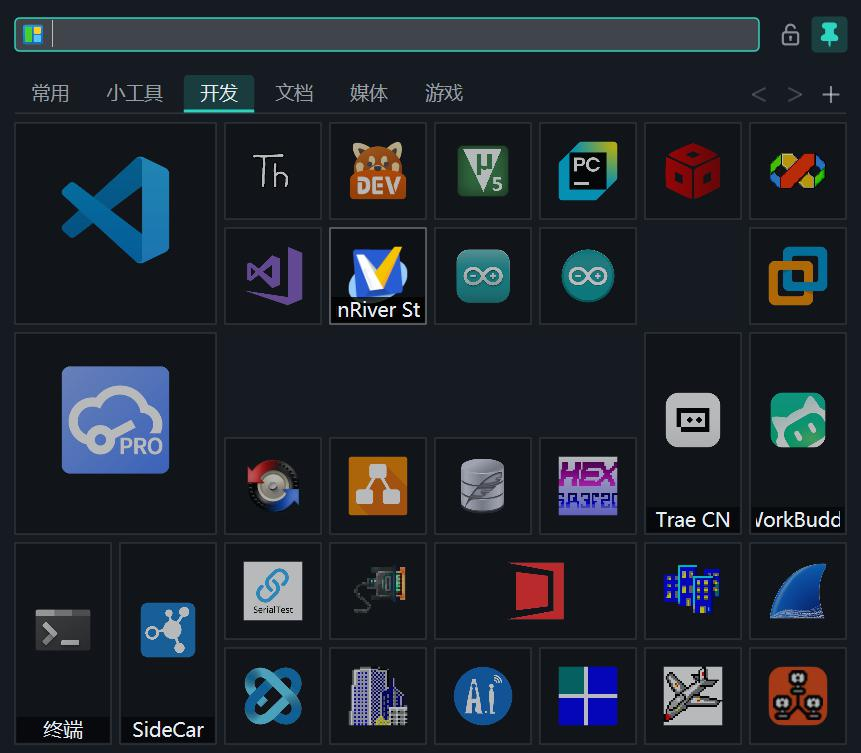
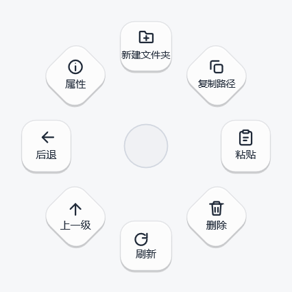

<div align="center">



# KTile 磁贴快启

**把常用应用、文件、文件夹和网址，收进一块随手可用的磁贴面板；**
**再把高频动作挂到鼠标上，按住右键一拖即达。**

*轻量 · 单文件 · 免安装 · 离线*

**简体中文** · [English](README.en.md)

[](https://www.microsoft.com/windows)
[](#)
[](LICENSE)
[](CHANGELOG.md)
[](#)

</div>

---

## 预览

<p align="center">
  
  <br>
  <sub>磁贴主面板：四档尺寸自由混排，多标签页分类</sub>
</p>

<p align="center">
  
  <br>
  <sub>轮盘菜单：<code>Ctrl</code> + 右键拖动呼出，松手执行高亮扇区（图中为资源管理器插件的轮盘）</sub>
</p>

## v1.3.1 更新

- **跟随启动** — 设置 → 行为 → 「开机自动启动」下面可以挂一串要跟着起来的程序：
  「添加…」选程序（exe / lnk / bat / cmd / com），列表里显示各自的图标与路径。
  KTile 启动后逐条拉起，**已经在运行的就跳过**——记事本、计算器这类经过
  「应用执行别名」启动的程序也认得出来，不会每次多开一份
- **磁贴上右键「跟随启动」** — 不用再翻文件对话框，在磁贴上右键勾一下就行，已添加
  的显示勾，再点一次即移除。这样加的条目按**磁贴自己的方式**启动：参数、工作目录、
  管理员权限都跟着磁贴走，磁贴改了它也改；磁贴被删掉时改用添加时的快照继续启动，
  不会被悄悄清掉。只在可执行的磁贴上开放
- **磁贴目标支持相对路径** — 目标写成 `tools\app.exe` 这种相对路径时，基准是
  `KTile.exe` 所在目录，不是当前工作目录：快捷方式启动、计划任务启动、从别的目录
  手点，解析结果都一样。启动、图标、类型推断、资源管理器定位共用同一层解析
- 修复：编辑窗口在英文界面下左列标签被裁字，改为按当前语言实测宽度排版

上一版（v1.3.0）带来轮盘插件（`slugin/`）、中英双语界面、一份通用轮盘 + 进程
黑名单、抑制键等。完整清单见 [CHANGELOG](CHANGELOG.md)，轮盘的设计与取舍见
[docs/radial-menu-design.md](docs/radial-menu-design.md)。

## 这是什么

KTile 是一款 Windows 原生磁贴式快速启动器：用可调大小的磁贴整理常用项目，
按快捷键唤出面板，输入名称即过滤，点击即启动。

整个程序是一个约 **1.3 MB** 的 `KTile.exe`——无需安装、无需运行库、完全离线，
配置与数据全部存放在 exe 同级的 `data` 目录，拷走即备份。

## 为什么做这个

我很喜欢 Windows 10 开始菜单的磁贴：图标大小错落、排布自由，既能把常用软件
放大突出，又能把零碎工具有序归置。可惜 Win11 砍掉了磁贴，Win7 则从来没有过。

更糟的是有一次我的 Win10 崩溃重置，其他东西都在，**开始菜单磁贴的布局却全丢了**
——那些精心排好的格子再也拼不回来。之后我把各类启动器试了个遍，功能都很强，
但就是没有磁贴那种自由混排的感觉。

于是花了一个周末，借助 AI 自己动手写了一个。目标很简单：
**轻便、实用、支持不同大小的磁贴图标自由组合**——也就是你现在看到的 KTile。

## 功能说明

### 1. 磁贴快启：点一下就开，还能带上一串常驻工具

磁贴是主界面。Small / Wide / Tall / Large 四档尺寸自由混排，行列数可配置，
多标签页分类；唤出面板后直接打字按名称过滤，点击即启动。

**跟随启动**是磁贴启动的延伸：日常要用的常驻工具（同步盘、输入法、聊天窗口）
不必挨个点，挂到 设置 → 行为 →「启动与唤醒」分组里的「跟随启动」——就在「开机
自动启动」下面——KTile 起来时一并拉起；已经在运行的就跳过，不会多开一份。

更顺手的加法是在磁贴上右键勾「跟随启动」——这样加的条目按磁贴自己的方式启动：
参数、工作目录、管理员权限全部取磁贴的，磁贴改了它跟着改；磁贴被删掉时改用
添加那一刻的快照继续启动，不会被悄悄清掉。

触发时机是「KTile 启动时」，跟 KTile 自己怎么起来无关（开机自启、托盘、快捷键、
点磁贴都算）。`--debug-*` 那些自动化入口不触发，免得跑一遍截图脚本满屏是进程。

> **待补插图** `docs/feature-follow.gif`：磁贴上右键勾「跟随启动」→ 重启 KTile →
> 常驻工具被自动拉起（截图或 GIF 均可）

### 2. 磁贴插件：磁贴不只是图标

一块磁贴可以显示实时内容：CPU 与内存占用、磁盘、电池、天气、任意 HTTP API 的
返回值、某条命令的输出。

插件是**纯声明式**的：`plugin/<id>/plugin.json` 描述数据源（本地指标 / HTTP /
命令行）与每种尺寸下的布局树，不需要写代码、不需要常驻进程。同一插件在不同尺寸
下可以给不同布局——大磁贴并列三天天气，小磁贴只显示当天。`refreshSeconds` 是
「面板唤出时」的缓存 TTL，`visibleRefreshSeconds` 是「面板正开着时」的高频刷新
间隔（系统监控 1 秒），面板隐藏后不再刷新。随包带「天气」与「系统监控」两个
示例，设置里可安装 / 删除。

> **待补插图** `docs/feature-plugin.gif`：磁贴插件安装与实时刷新（截图或 GIF 均可）

### 3. 鼠标轮盘：按应用换一套动作，熟了能盲操作

按住 `Ctrl` 再拖右键，环形菜单在光标处展开，拖向哪个扇区就执行哪一项，松手即
完成——中间不用点确认。扇区数 4 / 6 / 8 可选，触发键与修饰键都能改。

- **按应用换轮盘** — `slugin/` 下加一个目录就是加一个应用：`radial.json` 里写好
  适用进程名与扇区动作，切到那个程序就自动换成它的轮盘，没命中的回落到通用轮盘。
  不用写代码、不用重新编译
- **熟了能盲操作** — 扇区位置固定，用几天就成了肌肉记忆，拖一下比找菜单快得多
- **不熟也不慌** — 每个扇区都带图标和名称，看得见再选，不必先背下来
- **能和手势软件共存** — 默认要按住修饰键才触发，不给右键菜单添乱；抑制键可以
  给 `Alt+Tab`、`Alt+方向` 这类系统组合键让路，个别进程还能整个拉黑不弹

在我自己的用法里，它已经取代了鼠标手势：手势要记笔画，轮盘的候选一直摆在
眼前，拖偏了松手之前还能改。

> **待补插图** `docs/feature-radial.gif`：切到浏览器后轮盘自动换成浏览器那一套，
> 一路拖出去执行（截图或 GIF 均可）

### 4. 多语言：界面语种可切

内置简体中文与英文。首次运行跟随系统语言（系统是简体中文就用中文，其余一律
英文），之后在 设置 → 行为 → 界面语言 里随时切换，不用重启。

文案全部外置到 exe 同级的 `lang/<code>.json`：**加一门语言只要多放一个文件**，
不改代码也不重新编译。取词回退链是「当前语言 → 英语 → key 本身」，漏译的地方
会显示 `settings.title` 这样的字样而不是一片空白，好排查。写法见
[docs/i18n.md](docs/i18n.md)。

> **待补插图** `docs/feature-i18n.png`：同一界面在中文与英文下的对照
> （两张截图拼一张也行）

### 其他细节

- **三种添加方式** — 浏览文件、粘贴目标路径、直接从资源管理器拖入
- **目标可写相对路径** — `tools\app.exe` 这种写法以 `KTile.exe` 所在目录为基准，
  换个盘、换个文件夹整包搬走也不用逐条改；裸命令名（`notepad.exe`）仍交给系统按
  `PATH` 找
- **自定义图标** — 任意图片一键设为磁贴图标（自动缩放导入），或使用系统图标
- **内置系统项** — 21 个常用系统位置与命令（此电脑、回收站、锁屏、音量与媒体控制……）
- **皮肤系统** — 4 款深色 + 1 款浅色内置主题，JSON 皮肤文件可手改；支持独立背景图
- **不透明度** — 整窗与磁贴各自可调，百搭桌面
- **唤醒快捷键** — `Alt+Space` / `Ctrl+Space` / 双击 `Ctrl` / 单按 `Win` 四种预设，设置里即选即换
- **窗口出现位置** — 跟随鼠标 / 屏幕四角 / 居中 / 上次位置
- **绿色便携** — 不写注册表（唯一例外是「开机自启」会在 Run 键写一条自身路径）

## 两套插件：一块磁贴，一个轮盘

扩展性分成两条互不相干的线。两者都是「放个目录就算装好」，都不用写代码、不用
重新编译，主程序也不内嵌任何插件清单或图标：

| | 磁贴插件 `plugin/` | 轮盘插件 `slugin/` |
|---|---|---|
| 解决什么 | 磁贴里显示**实时内容**（天气、CPU、HTTP 返回值） | 换个前台程序就换**一套轮盘** |
| 清单位置 | `plugin/<id>/plugin.json` | `slugin/<id>/radial.json` |
| 数据来源 | 本地指标 / HTTP / 命令行 | 纯静态：适用进程名 + 扇区动作 |
| 生效方式 | 设置 → 插件管理 → 安装 / 删除 | 设置 → 轮盘插件 → 重新扫描 |
| 图标 | `plugin/<id>/icons/*.svg` | `slugin/<id>/icons/*.svg` |
| 随包示例 | 「天气」「系统监控」 | 「文件资源管理器」「浏览器」 |

exe 目录不可写时（如装在 `Program Files`）两者都会回落到 `data/plugin/`、
`data/slugin/`。清单格式与字段说明见下方[数据与配置](#数据与配置)。

## 快捷键

| 按键 | 作用 |
|------|------|
| `Alt+Space`（默认，可换） | 唤出 / 收起面板 |
| 输入文字 | 搜索过滤 |
| `Esc` | 清空搜索 / 收起面板 |
| `Ctrl+Tab` / `Ctrl+1..9` | 切换标签页 |
| `Ctrl` + 右键拖动（默认，可换） | 呼出轮盘菜单，松手执行高亮扇区 |
| 拖动磁贴 | 排序（其余磁贴自动让位） |
| 右键磁贴 | 运行、编辑、尺寸、移动/复制到其他页…… |

## 快速开始

1. 从 [Releases](https://github.com/svyee/KTile/releases) 下载 `KTile.zip`，解压到任意目录
2. 运行 `KTile.exe`（首次启动自带示例磁贴，编辑即可换成你自己的）
3. 按 `Alt+Space` 唤出面板

> 首次运行时 Windows SmartScreen 可能提示未签名，点「更多信息 → 仍要运行」即可；
> 也可以自己从源码构建（见下文）。

## 界面语言

功能见上文[第 4 节](#4-多语言界面语种可切)。这里是落盘方式：文案在 exe 同级的
`lang/<code>.json` 里，`code` 是语言标记（`zh-Hans`、`en`），`auto` 表示跟随系统。
加一门语言的完整步骤与注意事项见 [docs/i18n.md](docs/i18n.md)。

## 数据与配置

```
KTile.exe
plugin/
└── <id>/
    ├── plugin.json   # 磁贴插件清单（描述数据源与各尺寸布局）
    └── icons/*.svg   # 插件自带图标（也可用 png；SVG 支持局部彩色）
slugin/
└── <id>/
    ├── radial.json   # 轮盘插件清单（适用进程 + 扇区动作）
    └── icons/*.svg   # 轮盘按钮图标（也可用 png / ico）
data/
├── items.json     # 磁贴数据（可直接手改）
├── config.json    # 应用配置
├── radial.json    # 通用轮盘（触发方式 / 抑制键 / 扇区动作 / 进程黑名单）
├── themes/        # 皮肤（JSON，可自定义配色）
├── plugins/cache/ # 插件数据快照缓存（自动生成）
└── res/           # 导入的自定义图标
lang/
├── zh-Hans.json   # 简体中文文案
└── en.json        # 英文文案（加语言 = 加文件，见 docs/i18n.md）
```

插件是纯声明式的：`plugin/<id>/plugin.json` 描述数据源（本地内置 /
HTTP / 命令行）和每种磁贴尺寸下的布局树，不需要写代码，也不需要常驻进程。
清单里的 `refreshSeconds` 是「面板唤出时」的缓存 TTL，`visibleRefreshSeconds`
是「面板正开着时」的高频刷新间隔（如系统监控每 1 秒）；面板隐藏后不再刷新。
插件目录放在 exe 同级，一个插件一个子文件夹；exe 目录不可写时（如装在
`Program Files`）自动回落到 `data/plugin/`。仓库根的 `plugin/` 就是随发布包
分发的示例插件（「天气」默认福建泉州、「系统监控」），构建时由 `build.ps1`
原样拷到 exe 同级 —— 主程序不内嵌任何插件清单或图标。

在「设置 → 插件管理」里可以安装（选一个 `plugin.json`，整个文件夹会被复制
进来）、删除插件，或直接为某个插件添加磁贴。

### 轮盘插件（`slugin/`）

轮盘插件的形态是「一个目录 + 一份 JSON + 自己的图标」：`slugin/<id>/radial.json`
里的 `processes` 列出适用的进程名，`menu` 描述扇区动作（与通用轮盘同一套字段），
按钮图标写在动作的 `icon` 上、相对插件目录解析。前台进程命中就显示该插件的
轮盘，否则回落到通用轮盘；多个插件命中同一进程时 `priority` 大的优先。

```json
{
  "schemaVersion": 1,
  "name": "文件资源管理器",
  "processes": ["explorer.exe"],
  "priority": 0,
  "menu": {
    "name": "资源管理器",
    "sectorCount": 8,
    "actions": [
      { "type": "shortcut", "name": "新建文件夹",
        "modifiers": ["control", "shift"], "key": "N",
        "icon": "icons/folder-plus.svg" }
    ]
  }
}
```

改完 JSON 不必重启：设置 → 轮盘插件 →「重新扫描」即可（只改图标文件连扫描都
不用，渲染时会按文件修改时间自动失效）。仓库根的 `slugin/` 是随发布包分发的
示例（文件资源管理器），构建时由 `build.ps1` 原样拷到 exe 同级。图标建议按
24×24 画布画，与内置图标一致；写坏了只会跳过那一个插件，设置页会写明原因。

整个目录拷贝到 U 盘 / 新电脑即可迁移。

## 从源码构建

**要求**：Visual Studio 2022 Build Tools（MSVC 14.44，C++17）、Windows SDK 10.0.26100.0。
工具链路径硬编码在 `build.ps1` 顶部；本机安装位置或版本不同时，改这几行即可。
无需 CMake、vcpkg 或任何第三方库。

```powershell
git clone https://github.com/svyee/KTile.git
cd KTile
.\build.ps1                  # 构建 Release
.\build.ps1 -Debug           # Debug 构建
.\build.ps1 -Tests           # 编译并运行全部单元测试
.\build.ps1 -Clean           # 清空 build 目录
```

产物：`build/KTile.exe`（静态链接 `/MT`，无外部依赖）。

**技术栈**：纯 Win32 + Direct2D + DirectWrite，不依赖任何 UI 框架；
JSON 解析/序列化为零依赖自研实现。详见 [环境验证报告](docs/environment-report.md)。

## 项目结构

```
KTile/
├── src/
│   ├── app/            # 应用层：生命周期、托盘、热键、调试入口
│   ├── base/           # C++17 兼容层：expected / span / algo / 编码转换
│   ├── core/           # 领域层：磁贴布局、插件模型/绑定/布局、搜索、标签操作
│   ├── infrastructure/ # 持久化：JSON 解析/写入、便携路径、插件清单与缓存
│   ├── platform/win32/ # 平台层：D2D 基建、图标提取、拖放、热键、插件数据源
│   └── ui/             # 界面层：主窗口、编辑对话框、设置窗口、皮肤
├── plugin/             # 随发布包分发的示例磁贴插件（清单 + 图标，构建时拷到 build/）
├── slugin/             # 随发布包分发的示例轮盘插件（按应用，构建时拷到 build/slugin/）
├── tests/              # 单元测试（每个模块一个 test_*.cpp）
├── tools/              # 开发期代码生成：Lucide 图标、应用 ico
├── scripts/            # 构建环境脚本与诊断探针
├── docs/               # 文档与截图
├── assets/             # 设计源文件（应用图标母版 icon.png）
├── build.ps1           # 构建脚本（直接调用 cl.exe，无需 CMake）
└── build/              # 构建产物（已忽略）
```

## 参与贡献

欢迎通过 Issue 反馈问题或提交 PR。

- **发现 Bug**：请先在 [Issues](https://github.com/svyee/KTile/issues) 中搜索是否已有相同报告
- **功能建议**：开 Issue 描述使用场景与期望行为
- **代码贡献**：Fork 本仓库，在新分支上修改后提交 PR

构建与测试通过（`.\build.ps1 -Tests`）是提交 PR 的前提。

## 反馈与联系

- 邮箱：svyee@163.com
- 微信：svyeee

## 开源协议

本项目以 [Apache License 2.0](LICENSE) 发布——商用、修改、闭源分发都随你，
分发时保留 `LICENSE` 与 `NOTICE` 即可，改动过的文件请注明。

内置图标基于 [Lucide](https://lucide.dev)（ISC License），详见
[THIRD_PARTY_NOTICES.md](THIRD_PARTY_NOTICES.md)。
