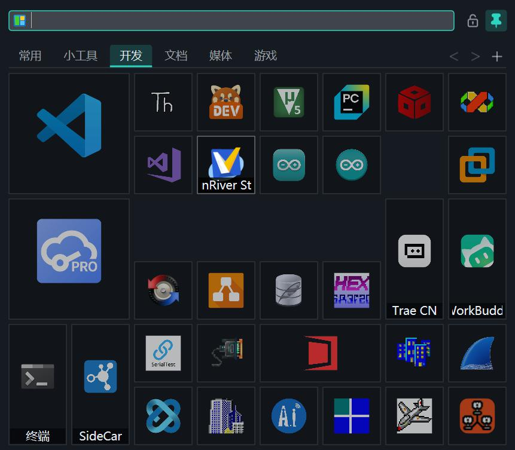

<div align="center">


# KTile 磁贴快启

**把常用应用、文件、文件夹和网址，放进一块随手可用的磁贴面板。**

*轻量 · 单文件 · 免安装 · 离线*


</div>

---

KTile 是一款 Windows 原生磁贴式快速启动器：用可调大小的磁贴整理常用项目，
按快捷键唤出，输入名称即搜索，点击即启动。整个程序是一个约 800 KB 的
`KTile.exe`，无需安装、无需运行库、完全离线。

<p align="center">
  
</p>

## 为什么有这个项目

我很喜欢 Windows 10 开始菜单的磁贴：图标大小错落、排布自由，既能把常用软件放大突出，又能把零碎工具有序归置。可惜 Win11 砍掉了磁贴，Win7 则从来没有过。

更糟的是有一次我的 Win10 崩溃重置，其他东西都在，**开始菜单磁贴的布局却全丢了**——那些精心排好的格子再也拼不回来。之后我把各类启动器试了个遍，功能都很强，但就是没有磁贴那种自由混排的感觉。

于是花了一个周末，借助 AI 自己动手写了一个。目标很简单：**轻便、实用、支持不同大小的磁贴图标自由组合**——也就是你现在看到的 KTile。

## 特性

- **磁贴混排** —— Small / Wide / Tall / Large 四档尺寸自由组合，行列数可配置
- **多标签页** —— 分类整理项目；点击、滚轮、`Ctrl+Tab`、`Ctrl+1..9` 切换
- **即输即搜** —— 唤出面板直接打字，磁贴按名称实时过滤
- **三种添加方式** —— 浏览文件、粘贴目标路径、直接从资源管理器拖入
- **自定义图标** —— 任意图片一键设为磁贴图标（自动缩放导入），或用系统图标
- **内置系统项** —— 22 个常用系统位置与命令（此电脑、回收站、锁屏、剪贴板路径……）
- **皮肤系统** —— 4 款深色 + 1 款浅色内置主题，JSON 皮肤文件可手改；支持独立背景图
- **不透明度** —— 整窗与磁贴各自可调，百搭桌面
- **唤醒快捷键** —— `Alt+Space` / `Ctrl+Space` / 双击 `Ctrl` / 单按 `Win` 四种预设，设置里即选即换
- **窗口出现位置** —— 跟随鼠标 / 屏幕四角 / 居中 / 上次位置
- **绿色便携** —— 配置与数据全部存放在 exe 同级的 `data` 目录，拷走即备份

## 快捷键

| 按键 | 作用 |
|------|------|
| `Alt+Space`（默认，可换） | 唤出 / 收起面板 |
| 输入文字 | 搜索过滤 |
| `Esc` | 清空搜索 / 收起面板 |
| `Ctrl+Tab` / `Ctrl+1..9` | 切换标签页 |
| 拖动磁贴 | 排序（其余磁贴自动让位） |
| 右键磁贴 | 运行、编辑、尺寸、移动到其他页…… |

## 快速开始

1. 从 [Releases](../../releases) 下载 `KTile.zip`，解压到任意目录
2. 运行 `KTile.exe`（首次启动自带示例磁贴，编辑即可换成你自己的）
3. 按 `Alt+Space` 唤出面板

> 首次运行时 Windows SmartScreen 可能提示未签名，点「更多信息 → 仍要运行」即可；
> 也可以自己从源码构建（见下文）。

## 数据与配置

```
KTile.exe
data/
├── items.json     # 磁贴数据（可直接手改）
├── config.json    # 应用配置
├── themes/        # 皮肤（JSON，可自定义配色）
└── res/           # 导入的自定义图标
```

整个目录拷贝到 U 盘 / 新电脑即可迁移，不写注册表（唯一的例外是
「开机自启」开关，会在注册表 Run 键写一条自己的路径）。

## 从源码构建

要求：Visual Studio 2017（工具集 14.16，C++17）、Windows 10 SDK 10.0.19041.0。

```powershell
git clone https://github.com/<your-name>/KTile.git
cd KTile
powershell -ExecutionPolicy Bypass -File .\build.ps1          # 构建
powershell -ExecutionPolicy Bypass -File .\build.ps1 -Tests   # 单元测试
```

产物：`build/KTile.exe`（静态链接 `/MT`，无外部依赖）。

技术栈：纯 Win32 + Direct2D + DirectWrite，不依赖任何 UI 框架；
JSON 解析/序列化为零依赖自研实现。

## 项目结构

```
KTile/
├── src/
│   ├── app/            # 应用层：生命周期、托盘、热键、调试入口
│   ├── core/           # 领域层：磁贴布局、数据模型、搜索、标签操作
│   ├── infrastructure/ # 持久化：JSON 解析/写入、便携路径
│   ├── platform/win32/ # 平台层：D2D 基建、图标提取、拖放、全局热键
│   └── ui/             # 界面层：主窗口、编辑对话框、设置窗口、皮肤
├── tests/              # 单元测试（每个模块一个 test_*.cpp）
├── tools/              # 开发期代码生成：Lucide 图标、应用 ico
├── scripts/            # 构建环境脚本与诊断探针（不参与编译）
├── docs/               # 文档与截图
├── assets/             # 设计源文件（应用图标母版 icon.png）
├── build.ps1           # 构建脚本（直接调用 cl.exe，无需 CMake）
└── build/              # 构建产物（已忽略）
```

## 反馈与联系

- 邮箱：svyee@163.com
- 微信：svyeee

欢迎提 Issue / PR。

## 开源协议

本项目以 [MIT License](LICENSE) 发布。
内置图标基于 [Lucide](https://lucide.dev)（ISC License），见
[THIRD_PARTY_NOTICES.md](THIRD_PARTY_NOTICES.md)。
